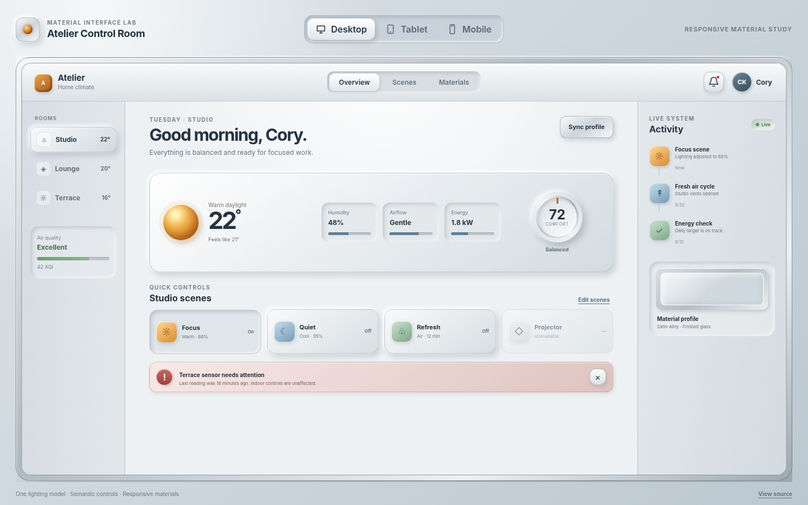
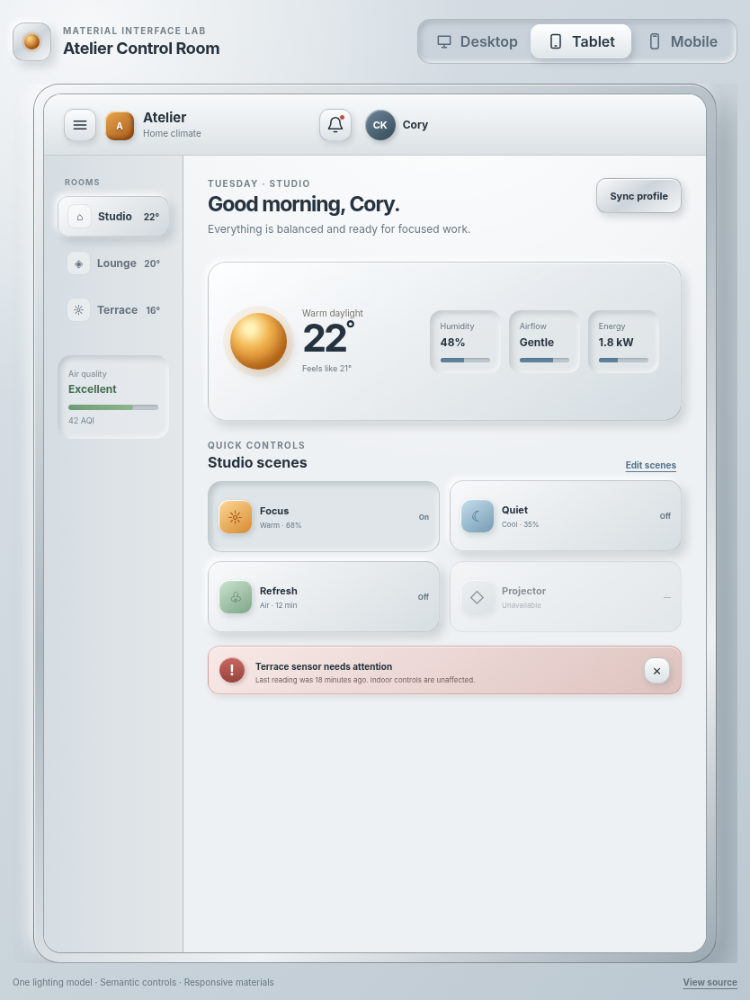
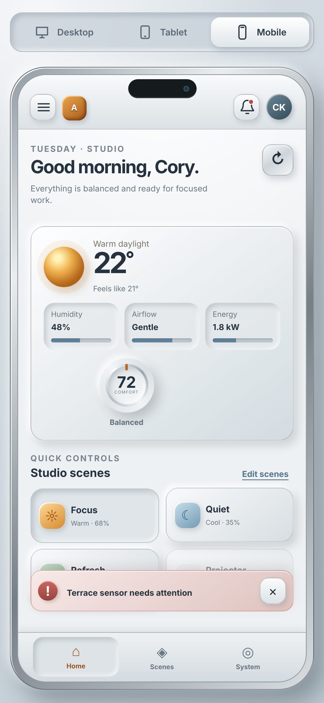

# Skeuomorphic Responsive Showcase

A source-owned HTML, CSS, and JavaScript interface that demonstrates one modern-skeuomorphic material system adapting across desktop, tablet, and a real iPhone 15 logical viewport.

**Repository:** https://github.com/hersaintel/skeuomorphic-responsive-showcase

## Responsive previews

The interface changes navigation, information density, spacing, control arrangement, and framing for each target—it does not scale a single desktop canvas.

### Desktop — 1440 × 900 CSS pixels (1× DSF)



### Tablet — 834 × 1112 CSS pixels (1× DSF)



### iPhone 15 — 393 × 852 CSS pixels (3× DSF)

The browser capture is **1179 × 2556 physical pixels**, matching a 393 × 852 logical viewport at device scale factor 3.



## What this verifies

- User-selectable Desktop, Tablet, and Mobile preview tabs with roving keyboard focus.
- Device-specific navigation and content density: desktop three-panel workspace, tablet two-panel workspace, and mobile bottom navigation.
- Visible default, hover, `:focus-visible`, pressed, selected, disabled, loading, and error states.
- Semantic links, buttons, landmarks, labels, live regions, and tab roles.
- Touch-friendly mobile controls and a safe-area-aware iPhone frame.
- Reduced-motion handling through `prefers-reduced-motion`.
- Readable foreground contrast independent of surface shadows and texture.

## Material and lighting system

The interface uses local CSS rather than a UI library. This keeps the implementation source-owned, dependency-light, and free from unreviewed production warnings.

- **Key light:** upper-left, expressed through bright top/left edges and lower-right cast shadows.
- **Satin alloy:** device chassis, app chrome, durable buttons, and the comfort dial.
- **Frosted glass:** weather console and material sample, with calm translucent data surfaces.
- **Molded plastic:** everyday scene controls and navigation tabs.
- **Elevation:** shared `--lifted`, `--pressed`, and `--key-shadow` shadow stacks.
- **State color:** amber for focus/light, blue for airflow, green for healthy status, and restrained red for recoverable errors.

## Architecture

The project is a static Vite application with no runtime framework:

1. `index.html` provides the semantic application and all responsive content.
2. `src/style.css` defines material tokens, interaction states, and device-specific adaptations.
3. `src/app.js` contains testable preview, keyboard, loading, error, and scene-control behavior.
4. `src/main.js` connects behavior to the document and reads the optional `?preview=` capture parameter.
5. Vitest checks JavaScript behavior; Playwright checks the rendered application and iPhone viewport fit.

## Project structure

```text
.
├── docs/images/                 # Real Playwright browser captures
├── src/
│   ├── app.js                   # Testable interaction behavior
│   ├── main.js                  # Browser entry point
│   └── style.css                # Responsive tactile design system
├── tests/
│   ├── e2e/showcase.spec.js     # Browser and viewport verification
│   └── unit/app.test.js         # Interaction unit tests
├── tools/capture-screenshots.mjs
├── index.html
├── playwright.config.js
└── vite.config.js
```

## Getting started

### Prerequisites

- Node.js 20 or newer
- npm

### Install and run

```bash
npm ci
npx playwright install chromium
npm run dev
```

Vite prints the local development URL after startup.

### Production build and preview

```bash
npm run build
npm run preview
```

## Verified quality commands

The following commands were run successfully against the committed implementation:

```bash
npm run lint
npm test
npm run build
npm run test:e2e
```

Run the complete gate with:

```bash
npm run check
```

To regenerate the screenshots, first run the production preview on port 4173, then capture:

```bash
npm run preview -- --port 4173
npm run screenshots
```

## Accessibility notes

- Preview tabs use `role="tab"`, `aria-selected`, roving `tabindex`, and arrow-key navigation.
- Native buttons and links preserve keyboard, touch, and assistive-technology behavior.
- Focus indicators use a high-visibility outline independent of depth or color.
- Loading feedback uses `aria-busy` and a polite live region.
- The sensor warning remains text-labeled and dismissible; state is not communicated by color alone.
- Disabled controls remain visibly distinct and use the native disabled state.
- Motion is reduced when the operating system requests reduced motion.

## Deployment status

**Not deployed.** The verified artifact is the production Vite build in `dist/`; no hosted application URL is claimed.

## License

[MIT](LICENSE)

## Author

Built by [@hersaintel](https://github.com/hersaintel).
